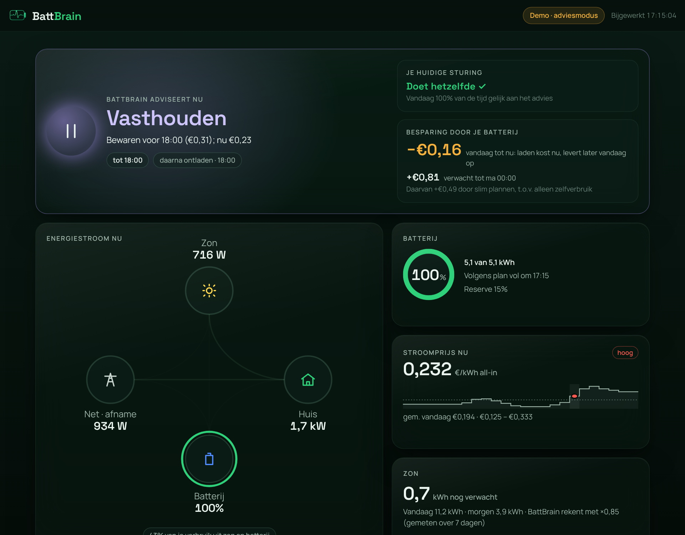

# 🧠🔋 BattBrain

**Je thuisbatterij slim laten werken op dynamische prijzen, zonder cloud en zonder abonnement.**

BattBrain is een app voor Home Assistant die elk kwartier een plan maakt voor je thuisbatterij: wanneer laden
van het net, wanneer zon opslaan, wanneer vasthouden en wanneer ontladen. Het rekent met de prijzen van vandaag
en morgen, je zonverwachting en je eigen verbruikspatroon, en legt elke beslissing uit in gewone taal.
Het is klaar voor 2027, als salderen stopt en terugleveren minder oplevert.



- **Onafhankelijk.** Draait lokaal in je eigen Home Assistant. Geen account, geen telemetrie, geen leverancier die meekijkt.
- **Eerst bewijzen, dan sturen.** Standaard alleen advies, naast je huidige automatisering. De terugblik laat
  op je eigen data van de afgelopen week zien wat BattBrain had opgeleverd.
- **Veilig sturen.** BattBrain raakt alleen de reserveschakelaar en het doel-SoC aan. Bij twijfel valt het terug
  op gewoon zelfverbruik; nooit laden boven je maximumprijs; een pauzeknop in het dashboard.
- **Open source** (AGPL-3.0). Lees precies wat er met je batterij gebeurt.

> English: BattBrain is a self-hosted Home Assistant app that plans your home battery every 15 minutes on dynamic
> prices, solar forecast and your own consumption. Local only, no cloud, open source. The interface is Dutch for now.

## In tien minuten draaien

**Home Assistant OS / Supervised**

1. **Instellingen → Apps** (voorheen Add-ons) → **Store** → ⋮ → **Repositories**, voeg toe:
   `https://github.com/pwnypower/Smartcharging-HA`
2. Installeer **BattBrain** en start hem. BattBrain zoekt zelf je sensoren.
3. Open **BattBrain** in de zijbalk en kijk bij **Installatie** onderaan of alles groen is.
   Wat ontbreekt, vul je in via *Configuratie* (zie [`app/DOCS.md`](app/DOCS.md)).

**Home Assistant Container / Core:** zie [`standalone/`](standalone/docker-compose.yml) (Docker Compose).

**Eerst kijken zonder iets te installeren:** `cd battbrain/app && python3 -m battbrain_app --demo`, open daarna http://localhost:8099.

Werkt met elke batterij die in Home Assistant een laadtoestand, een reserve-/netlaadschakelaar en een doel-SoC
heeft (getest met Solis S5-EH1P), en met elke prijssensor die de prijzen van vandaag en morgen als attribuut
heeft (Frank Energie, Zonneplan, Tibber, EnergyZero, Nordpool en andere).

## Wat het oplevert

Gemeten op een echte installatie (Solis, 5,1 kWh, Frank Energie, 7–9 oktober 2026; zie [`../simulator`](../simulator)):

| Besparing t.o.v. geen batterij | Nu (salderen) | 2027 |
|---|---|---|
| Alleen zelfverbruik | €0,74 | €2,27 |
| Blueprint-automatisering | €0,77 | €2,00 |
| **BattBrain** | **€0,86** | **€2,39** |
| Theoretisch maximum (perfecte voorspelling) | €1,12 | €2,49 |

Drie herfstdagen met weinig zon en kleine prijsverschillen: daar valt weinig te halen, en BattBrain haalt er
het meeste uit. Het verschil groeit in 2027, en in seizoenen met grotere prijsverschillen. De kaart *Terugblik*
rekent het voor jouw eigen installatie uit.

## Hoe het werkt

1. **Slots:** voor elk kwartier waarvan de prijs bekend is: all-in prijs, terugleververgoeding,
   verwacht verbruik (geleerd uit je geschiedenis) en verwachte zon (Forecast.Solar, gecorrigeerd met je echte opbrengst).
2. **Plan:** dynamisch programmeren zoekt het laadpad met de laagste kosten, met laad-/ontlaadvermogen,
   verliezen en je minimale reserve.
3. **Uitleg:** elke stap krijgt een actie en een reden in gewone taal.
4. **Sturing (opt-in):** de stap van nu wordt de reserveschakelaar + doel-SoC, met veiligheidsregels.

```python
from battbrain_core import Battery, LoadProfile, build_slots, make_plan, control_for

bat = Battery(capacity_kwh=5.1, max_charge_kw=3.0, max_discharge_kw=3.0, reserve_soc=15)
slots = build_slots(now, prices, solar_kwh=lambda t: 0.0, load=LoadProfile().fit(history),
                    export_price=lambda p: p - 0.15)   # 2027: teruglevering levert minder op
plan = make_plan(soc=42, slots=slots, bat=bat)
print(plan.steps[0].action.label, "—", plan.steps[0].reason)
print(control_for(plan.steps[0], soc=42, bat=bat))
```

## Mappen

| Map | Inhoud |
|---|---|
| [`app/`](app/) | De app: `battbrain_core` (planner, voorspellingen, omvormermodel), `battbrain_app` (HA-koppeling, installatiecheck, terugblik, sturing, webserver), `web/` (dashboard) |
| [`standalone/`](standalone/) | Docker Compose voor HA Container / Core |
| [`DESIGN.md`](DESIGN.md), [`design/`](design/) | Ontwerpbesluiten en het originele designpakket |
| [`marketing/`](marketing/) | Launchkit: landingspagina, pitch, posts, FAQ |
| [`V1_GOAL.md`](V1_GOAL.md) | Wat 1.0 inhoudt en wat nog openstaat |

## Tests

```bash
cd battbrain/app && python3 -m unittest discover -s tests
```

Geen afhankelijkheden: alleen de standaardbibliotheek van Python 3.11+.

## Licentie

[AGPL-3.0](LICENSE). Gebruiken, aanpassen en delen mag; bied je een aangepaste versie aan anderen aan, ook als
dienst via internet, dan deel je de broncode.
